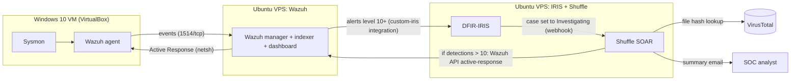

# SOC Home Lab: Wazuh + DFIR-IRIS + Shuffle


> An open-source Security Operations Centre lab that takes a credential-dumping attack
> (Mimikatz, MITRE ATT&CK T1003) from endpoint telemetry to a SIEM alert, an
> incident-response case and an automated threat-intelligence lookup, at zero licensing cost.

Capstone project, BSc Applied Computing, KCA University (unit BAC 4500).
Built and documented by [Ian Obiero](https://www.linkedin.com/in/ian-obiero-2242b6272/).

## At a glance

| | |
|---|---|
| **Detects** | Mimikatz credential dumping on a Windows 10 endpoint (Sysmon + Wazuh), mapped to ATT&CK T1003 |
| **Investigates** | High-severity alerts (level 10+) are pushed into DFIR-IRIS as alerts, then promoted to cases |
| **Automates** | Setting a case to "Investigating" triggers a Shuffle playbook that looks up file hashes on VirusTotal |
| **Responds** | Shuffle can call the Wazuh API to run an Active Response (netsh block) on the endpoint (validation in progress, see Limitations) |
| **Cost** | Open-source tools only |

## Contents

1. [Why this project](#why-this-project)
2. [Architecture](#architecture)
3. [Detection-to-response flow](#detection-to-response-flow)
4. [Validation results](#validation-results)
5. [Custom detections](#custom-detections)
6. [Repository structure](#repository-structure)
7. [Reproduce the lab](#reproduce-the-lab)
8. [Lessons learned](#lessons-learned)
9. [Limitations and roadmap](#limitations-and-roadmap)
10. [Safety and ethical use](#safety-and-ethical-use)
11. [Documentation](#documentation)
12. [Acknowledgements](#acknowledgements)
13. [License](#license)

## Why this project

Commercial SIEM and SOAR platforms are expensive, and most security coursework stops at theory.
This lab shows that a working detection, investigation and response pipeline can be built from
open-source parts and run on modest infrastructure, so students can practise real SOC workflows
(triage, case management, enrichment, response) safely.

## Architecture


*Figure: design diagram (draw.io source in `architecture/`).*

| Component | Version | Role | Runs on |
|---|---|---|---|
| Wazuh (manager, indexer, dashboard) | 4.7.3 | SIEM/XDR: collection, decoding, rules, alerts, Active Response | Ubuntu 22.04 VPS |
| IRIS | 5.2.0 | Alerts, cases, timeline, IOCs, evidence | Ubuntu 22.04 VPS |
| Shuffle | 1.2.0 | SOAR: enrichment and response playbooks | Ubuntu 22.04 VPS |
| Windows 10 + Sysmon + Wazuh agent | n/a | Monitored endpoint and attack target | VirtualBox VM |
| Kali Linux (planned agent) | n/a | Attack source for multi-host scenarios | VirtualBox VM |

<!-- EDIT: confirm which services share a VPS and whether Elasticsearch or the Wazuh indexer is used. -->

## Detection-to-response flow



1. Sysmon records process, file and network activity on the endpoint.
2. The Wazuh agent ships events to the manager over an encrypted channel.
3. The manager decodes events and matches them against rules; matches become alerts.
4. Alerts at level 10 or above are forwarded to IRIS by `integrations/custom-iris.py`.
5. The analyst triages the IRIS alert and promotes it to a case.
6. Setting the case to **Investigating** fires a webhook to Shuffle.
7. Shuffle looks up the file hash on VirusTotal. If detections exceed the threshold it asks Wazuh to run an Active Response on the endpoint.

## Validation results

Primary test: run Mimikatz (`sekurlsa::logonpasswords`) on the Windows 10 VM, in the isolated lab only.

| ID | Test | Result |
|---|---|---|
| TC-01 | Sysmon generates events on the endpoint | PASS |
| TC-02 | Wazuh agent service running | PASS |
| TC-03 | Agent active, process events visible in dashboard | PASS |
| TC-04 | IRIS receives alert from Wazuh | PASS |
| TC-05 | Shuffle playbook fires when case set to Investigating | PASS |
| TC-06 | Mimikatz detected with MITRE T1003 tag | PASS |
| TC-07 | Active Response blocks IP on endpoint | PENDING |
| TC-08 | Log stream uninterrupted during attack | PASS |

Detection time (Sysmon event to Wazuh alert): **<fill in> seconds** (target: under 60).

Evidence for every test is in [`screenshots/`](screenshots/) and described in [`testing/test-cases.md`](testing/test-cases.md).


## Custom detections

| Rule ID | Level | Purpose | ATT&CK | Status |
|---|---|---|---|---|
| 100002 | 15 | Mimikatz usage (Sysmon process creation) | T1003 | Validated |
| 100100 | 5 | Single SSH password failure | T1110 | Not yet validated |
| 100101 | 12 | Repeated SSH failures from one source | T1110 | Not yet validated |
| 100200 | 8 | Process started from temp or download folder | T1204 | Not yet validated |

Rule files and notes: [`detections/`](detections/).

## Repository structure

```
.
├── README.md
├── architecture/     design diagram (png + draw.io) and flow explanation
├── detections/       custom Wazuh rules and ATT&CK mapping
├── integrations/     Wazuh to IRIS forwarder (sanitised)
├── playbooks/        Shuffle workflow export and node-by-node notes
├── testing/          test cases and the Mimikatz simulation procedure
├── screenshots/      evidence (redacted)
├── docs/             implementation plan, test plan, user manual, final report, slides
└── .github/workflows secret scanning
```

## Reproduce the lab

**Prerequisites:** two Ubuntu 22.04 hosts (VPS or VMs, 4 GB RAM minimum each), Docker and Docker Compose, VirtualBox with a Windows 10 VM, a free VirusTotal API key.

1. **Open firewall ports** on the Wazuh host: 1514/tcp (agents), 1515/tcp (enrolment), 443/tcp (dashboard).
2. **Deploy Wazuh** (single node, Docker reference, adjust to your method):
   ```bash
   git clone https://github.com/wazuh/wazuh-docker.git -b v4.7.3
   cd wazuh-docker/single-node
   docker compose -f generate-indexer-certs.yml run --rm generator
   docker compose up -d
   ```
3. **Deploy DFIR-IRIS**:
   ```bash
   git clone https://github.com/dfir-iris/iris-web.git
   cd iris-web && git checkout <release-tag>   # pin the release you actually run
   cp .env.model .env                   # then change every default secret
   docker compose build && docker compose up -d
   ```
4. **Deploy Shuffle**:
   ```bash
   git clone https://github.com/Shuffle/Shuffle.git && cd Shuffle
   sudo sysctl -w vm.max_map_count=262144
   mkdir -p shuffle-database && sudo chown -R 1000:1000 shuffle-database
   docker compose up -d
   ```
5. **Install Sysmon and the Wazuh agent** on the Windows VM and confirm the agent shows **Active**.
6. **Install the IRIS forwarder**: follow [`integrations/README.md`](integrations/README.md).
7. **Load the custom rules**: copy [`detections/`](detections/) rules into `/var/ossec/etc/rules/local_rules.xml` and restart the manager.
8. **Import the Shuffle playbook** from [`playbooks/`](playbooks/) and add your own VirusTotal and Wazuh credentials in Shuffle settings.
9. **Run the test** in [`testing/mimikatz-simulation.md`](testing/mimikatz-simulation.md).

Copy `.env.example` to `.env` and fill in your own values. Never commit real secrets.

<!-- EDIT: replace versions and commands with exactly what you ran. -->

## Lessons learned

<!-- EDIT: these are drafts from the project documents; keep only what is true for you. -->

- A level-10 threshold on single SSH failures floods IRIS. Single events should stay low and correlation rules should carry the high level.
- Frequency rules need `if_matched_sid`, not `if_sid`, to correlate events.
- Self-signed certificates break integrations silently until TLS verification is configured explicitly.
- VPS latency makes dashboards feel slow; judge detection time from event timestamps, not from the screen.
- Documentation drifts from reality fast, so every claim in this repo is backed by a screenshot or a config file.

## Limitations and roadmap

- [ ] Complete and document Active Response validation (TC-07)
- [ ] Complete IRIS to Shuffle automation end to end
- [ ] Add the Kali Linux agent and test the SSH brute-force rules
- [ ] Add AbuseIPDB enrichment next to VirusTotal
- [ ] Add email alerting from Shuffle
- [ ] Add LSASS access detection (Sysmon Event ID 10) so detection does not rely on the binary name
- [ ] Add more ATT&CK scenarios (lateral movement, persistence, ransomware behaviour)

## Safety and ethical use

Attack simulations run only inside this isolated lab, on systems I own. No malware binaries are
included in this repository. Do not run these techniques against systems you do not own or
have written permission to test. See [SECURITY.md](SECURITY.md).

## Documentation

| Document | Purpose |
|---|---|
| [Implementation plan](docs/01-implementation-plan.pdf) | Build phases, configuration, code samples |
| [Test plan](docs/02-test-plan.pdf) | Strategy, procedures, evidence |
| [User manual](docs/03-user-manual.pdf) | Day-to-day operation and troubleshooting |
| [Final report](docs/04-final-report.pdf) | Full project report and results |
| [Slides](docs/SOC-Home-Lab-Presentation.pdf) | Project presentation |
| [Control mapping](docs/control-mapping.md) | Lab capabilities mapped to NIST CSF 2.0 and ISO 27001:2022 |

## Acknowledgements

Wazuh, DFIR-IRIS and Shuffle maintainers; the MITRE ATT&CK team; Sysmon (Microsoft Sysinternals).
Supervisor: Fredrick Omondi.
Design inspired by public community SOC-automation labs (for example the MyDFIR series).
<!-- EDIT: keep or remove the last line, but if you followed a tutorial, crediting it is safer. -->

## License

[MIT](LICENSE)
